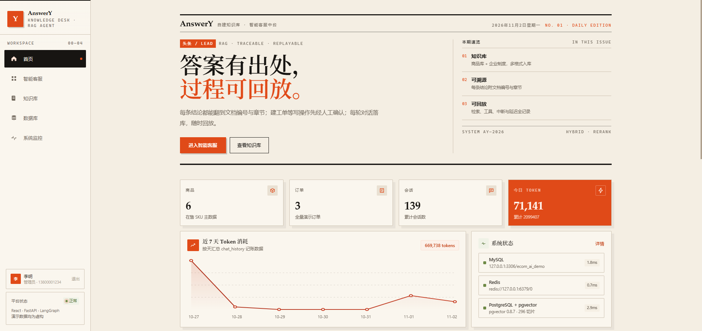
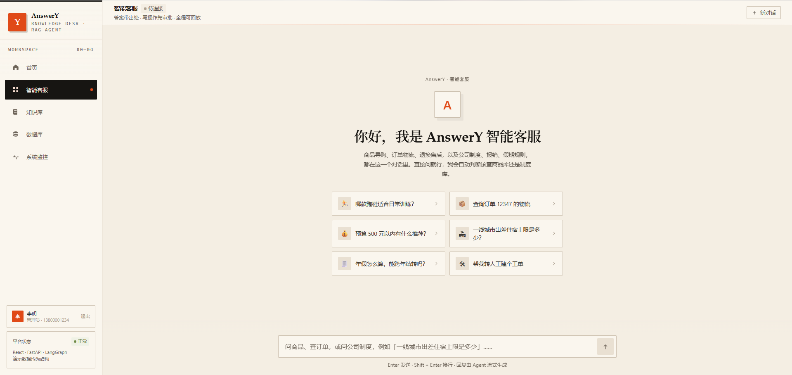
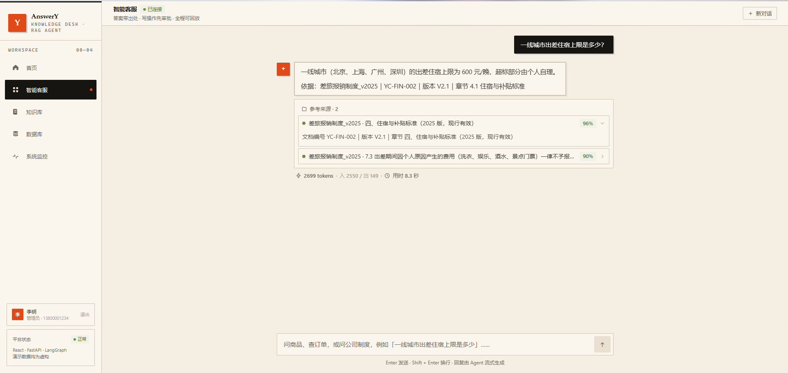
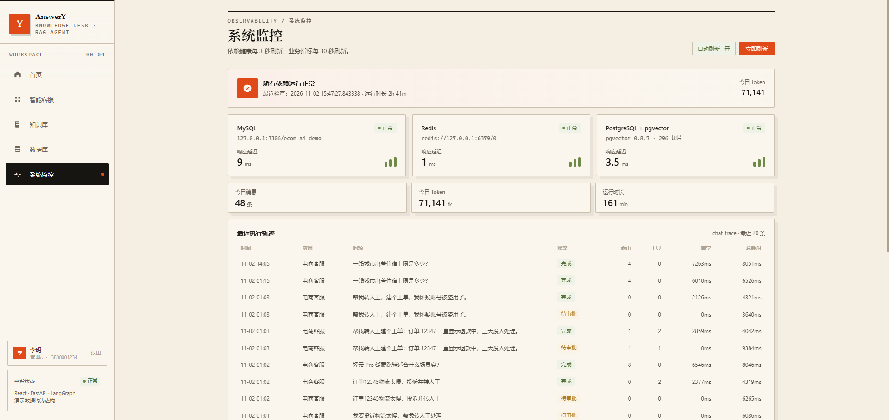
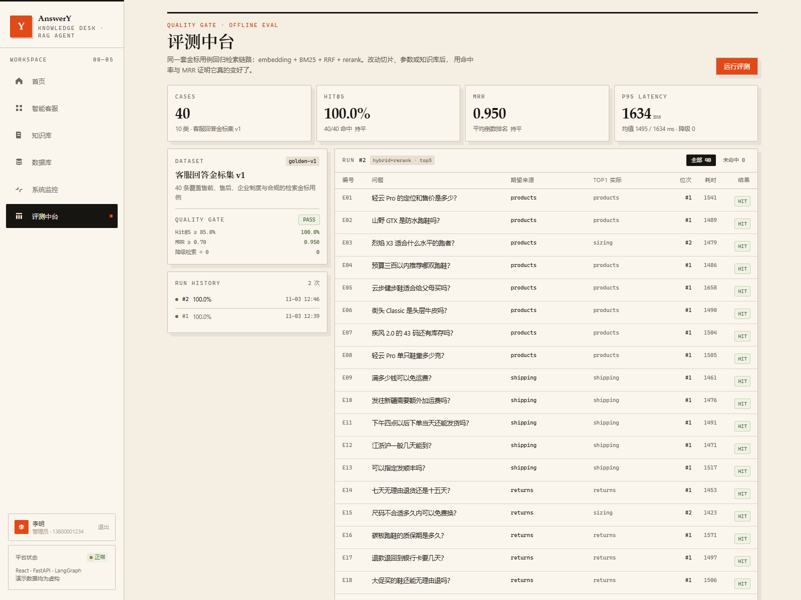
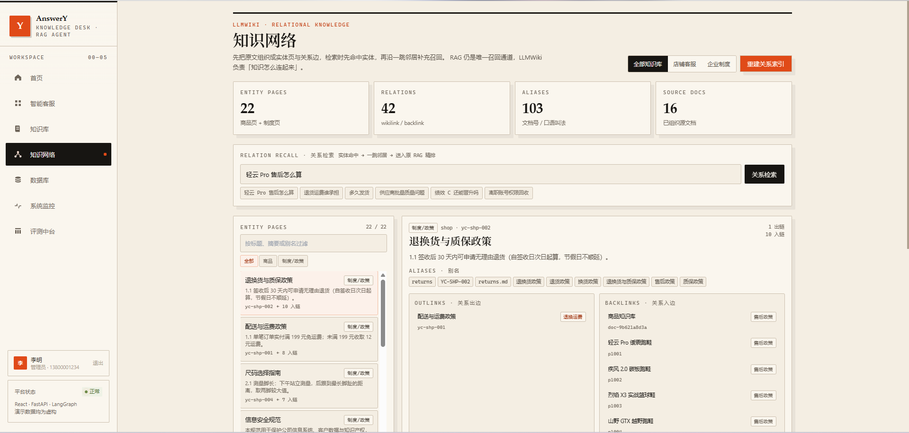
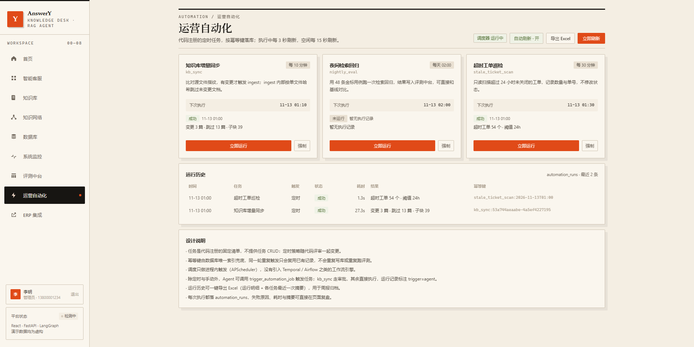
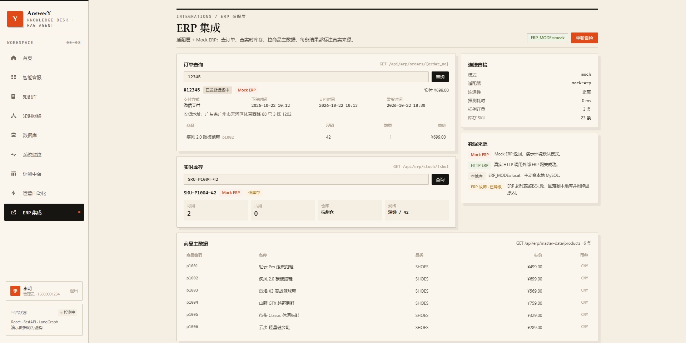

# AnswerY智能客服中台

> AnswerY = **Answer You**。一个 **Function Calling + pgvector 混合检索 + Neo4j 知识图谱 + LangGraph Agent** 的客服中台：**回答带出处、写操作先审批、全过程可回放**，覆盖电商导购与企业制度问答。

同一套 Agent 运行时、同一条检索链路、同一套鉴权与监控。工作台只有一个输入框——商品、订单、制度问题都能问，系统按语义判断该查文档还是调工具。

现在的主线能力：**混合检索（pgvector + BM25 + RRF）→ Neo4j 图谱关系召回（实体命中 → 2 跳扩展 → 路径解释）→ rerank → 引用到章节页码 → 8 个工具 → 写操作 HITL 审批 → 轨迹落库**；外层配 **48 条回归评测（Hit@5 100% / MRR 0.948）**、**APScheduler 运营自动化** 和 **可替换的 ERP 适配层（内置 Mock ERP）**。关系召回是一路可关的增强通道：`WIKI_ENABLED=false` 时主链路照常工作，Neo4j 不可用时退回 pg 副本并降级为纯检索。

       

## 能力地图

| 模块 | 现在有什么 | 状态 |
| --- | --- | --- |
| 对话编排 | LangGraph `route → agent ⇄ tools → approval → resume`，SSE 六类事件帧 | 已实现 |
| 混合检索 | pgvector HNSW + 中文 BM25 + RRF + rerank，父子切片，429 时降级 BM25-only | 已实现 |
| 引用溯源 | 回答标注「文档名 / 编号 / 版本 / 章节 / 页码」 | 已实现 |
| 业务工具 | 商品检索、商品详情、ERP 实时库存、订单、政策、优惠券、工单、自动化触发 | 8 个 |
| 写操作审批 | `interrupt()` 暂停 → 前端批准 / 拒绝 → `resume` 恢复 | 已实现 |
| 知识关系层 | Neo4j 实体页 + 有向关系边、别名归一、wikilink / backlink、2 跳关系召回与关系上下文 | 已实现 |
| 评测中台 | 48 条 / 11 类，Hit@5 100%、MRR 0.948，A/B、门禁、LLM 裁判、复盘导出 | 已实现 |
| 运营自动化 | 3 个定时任务、运行历史、Agent 触发、Excel 导出 | 已实现 |
| ERP 集成 | 适配层 + Mock ERP，`local / mock / http` 三模式，故障降级并标注来源，只读演示页 | 已实现（模拟数据） |
| 代码沙箱 | Docker 隔离执行 Python / Node，禁网、只读、超时重建 | 已实现（可选） |
| 可观测与安全 | `chat_trace`、JWT + RBAC、工具幂等、会话与全站额度 | 已实现 |
| Neo4j 知识图谱 | 实体页 / 关系边主存、Cypher 2 跳扩展、最短路径解释、健康检查与监控 | 已实现 |

## 界面预览

| 控制台首页 | 智能客服 |
| --- | --- |
|  |  |

| 带出处的回答 | 运行监控 |
| --- | --- |
|  |  |

| 评测中台 | 知识网络（关系召回增强） |
| --- | --- |
|  |  |

| 运营自动化 | ERP 集成（适配层 + Mock ERP） |
| --- | --- |
|  |  |

> 截图来自本机演示环境，数据均为虚构。Neo4j 没有独立页面，图谱数据通过「知识网络」页的实体页、出边 / 入边与关系路径展示。

## 知识关系层（LLMWiki）：RAG 之外的召回增强

LLMWiki 对应 Karpathy 提出的 **LLM Wiki** 模式：入库时把文档编译成带双向链接的持久 Wiki，查询时先命中实体、再沿链接取邻居；相关做法可参考[这篇论文](https://arxiv.org/pdf/2605.25480)。普通 RAG 把文档切成互不相干的 chunk，能召回「一段话」，但接不住「轻云 Pro 的售后按哪份政策」「这条供应商问题最终该看哪份制度」这类**需要跨一篇取值**的问题。LLMWiki 在切片之上补了一层可读的知识组织：

> 定位说明：这是**检索增强项**，不是主链路。`WIKI_ENABLED=false` 时，向量 + BM25 + RRF + rerank 照常工作；前端「知识网络」页也只用于观察关系层，不影响对话入口。

- **实体页**：店铺商品按 `pXXXX` 章节拆成独立商品页，五份政策各成一页；企业侧每份制度一个实体页。每页带标题、摘要、原文摘录与来源文档。
- **别名索引**：文档编号（`YC-SH-005`）、文件名（`05_客服升级SOP`）、口语叫法（「退货政策」「商品知识库」）都会归一到同一实体，用户不必说全称。
- **有向关系**：商品 → 售后 / 配送 / 尺码政策，跑鞋之间互为「同类对比」，制度里点名的《X 办法》与文档编号自动生成「引用制度」边，另有少量业务补边（绩效 ↔ 晋升、安全 ↔ 数据合规）。反向关系自动生成 backlink。
- **关系召回通道**：检索时先按标题 / 别名 / 摘要 BM25 命中实体页，再到 Neo4j 图上做 2 跳扩展（`WIKI_HOP=2`，Cypher 查询），取扩展到的页对应原文章节作为**额外候选**，与原向量 / BM25 候选一起走同一次 rerank。RAG 主链路、RRF 与精排阈值不变；实体命中只给原文章节一个很小的先验加成，排序仍由精排决定。
- **关系上下文**：把「实体摘要 + 关系路径（含两跳桥接）+ 邻居摘要」压缩成一段 `【LLMWiki 关系知识】` 注入提示词，回答能说清「依据哪份制度、和哪条政策相关」。
- **后台索引**：实体页与关系边写入 Neo4j（`Entity` 节点 + `RELATED` 边），启动时若为空则后台自动构建，不阻塞服务；pg 的 `wiki_pages / wiki_links` 保留为副本，Neo4j 不可用时回落，管理端可一键重建。

前端「知识网络」页可直接演示：左侧实体列表与类型筛选，右侧实体页的别名、出边、入边与原文摘录，顶部搜索框跑关系检索并展示「命中 → 一跳 / 两跳」路径和最终上下文。管理接口（均需管理员 Token）：`GET /api/admin/wiki/overview`、`GET /api/admin/wiki/pages`、`GET /api/admin/wiki/pages/{slug}`、`GET /api/admin/wiki/search`、`GET /api/admin/wiki/path`、`GET /api/admin/wiki/graph`、`POST /api/admin/wiki/rebuild`。

## 评测中台：让「回答变好」有数字依据

RAG 项目常见的问题是能问答、能引用，但说不清改完提示词、切片或 rerank 参数之后**到底有没有变好**。这里补了一层可重复的检索评测：

- **48 条自建回归评测集 / 11 类场景**：商品、物流、售后、营销、尺码、关系推理，以及企业制度、信息安全、客服管理、人力资源、合规；每条绑定「必须命中的文档」，判定粒度为文档级。
- **一次跑批 = 一次可对比的回归**：复用同一套检索组件（embedding + BM25 + RRF + rerank + LLMWiki 关系召回）按单库评测，线上为 shop / enterprise 两库各自召回后合并精排；逐条记录首中位次、TopK 来源、耗时与降级原因。
- **指标可解释**：`Hit@5`（期望文档是否进入 Top5 来源）、`MRR`（首个正确来源的平均倒数排名）、`P95 延迟`、`降级检索数`。
- **分场景切片**：11 类场景各自计算 Hit@5 / MRR / P95，整体分数好看但某类掉分时会立刻暴露。
- **A/B 对比**：任意两次运行互为基线，输出 `ΔHit@5`、`ΔMRR`、`ΔP95`，并列出逐条提升 / 退化用例。
- **质量门禁**：`Hit@5 ≥ 85%`、`MRR ≥ 0.70` 才显示 PASS；降级检索数单独展示，低于阈值需要先复盘 bad case，再改检索。
- **人工复盘 + 报告导出**：每条用例可标记「待复盘 / 已修复 / 已忽略」，状态跨 run 保留；一键导出带 BOM 的 CSV，Excel 直接打开。
- **生成质量评测（LLM-as-judge）**：基于跑批得到的检索上下文生成回答，再由裁判模型输出忠实度、相关性（1-5）与引用正确性，按 `10 / 20 / 40` 抽样控制成本，补齐「检索命中 ≠ 回答可信」。注意此处使用通用客服提示词，不是线上 Agent 提示词。
- **数据集在线维护**：用例增删改 + CSV 导入（中英文表头、按编号幂等覆盖），不用改代码或重跑种子脚本。
- **线上抽样回灌**：从 `chat_trace` 拉取尚未进评测集的真实问题，一键填入表单，补一个期望来源即可沉淀为回归用例。
- **可下钻**：每条用例能看到期望来源、实际 Top1、命中位次和完整 TopK 文档，不用猜。

最近一次真实运行（`run #7`，本机 MySQL + pgvector + 硅基流动 rerank，含 LLMWiki 关系召回）：

| 指标 | 结果 | 说明 |
| --- | --- | --- |
| 用例 / 分类 | 48 / 11 | 电商 29 条 + 企业 19 条 |
| Hit@5 | **100.0%**（48/48） | 期望文档全部进入 Top5 来源 |
| MRR | **0.948** | 多数用例首个来源即命中 |
| 平均 / P95 延迟 | 1519 / 1687 ms | 含 embedding + 双路召回 + 关系召回 + 全量候选 rerank |
| 降级检索 | 0 | 无 embedding / rerank 降级 |
| 关系推理切片 | **8/8 命中，MRR 0.938** | 商品 → 政策、制度 → 引用制度、绩效 → 晋升等跨文档问题 |
| A/B（`top1` → `top5`，run #3/#4） | **+10.0 pp / +0.050 MRR** | 基线为 90.0% / 0.900；4 条提升、0 条退化 |
| 生成质量抽样 | 2/2 PASS（run #4） | 裁判命中 `products` / `coupons`，忠实度与引用均正确 |

> 口径说明：48 条为自建标注样本，判定粒度为文档级（同文档不同章节不计为命中），用于策略变更前后的回归对比，不作为绝对水平背书。

跑批在后台执行、前端轮询进度，单条结果边跑边落库；接口为 `POST /api/admin/eval/runs`、`GET /api/admin/eval/runs/{id}`、`GET /api/admin/eval/overview`、`GET /api/admin/eval/runs/{id}/compare`、`GET /api/admin/eval/runs/{id}/export`、`POST /api/admin/eval/cases/{id}/review`、`POST /api/admin/eval/runs/{id}/judge`、`GET /api/admin/eval/runs/{id}/judgments`、`POST/PUT/DELETE /api/admin/eval/datasets/{id}/cases`、`POST /api/admin/eval/datasets/{id}/cases/import`、`GET /api/admin/eval/candidates`，全部要求管理员 Token。复现：

```bash
cd backend
$env:PYTHONPATH="."; python scripts/seed_eval.py --run
```

## 这个项目解决什么问题

企业做客服智能化，常见做法是接一个开源问答平台，把文档丢进去，然后被三个问题卡住：

1. **回答不可追溯**：员工或客户追问「依据是哪份文件、哪一版」，系统答不上来；
2. **只会说话不会办事**：查订单、查物流、建工单这类动作，纯 RAG 做不到；
3. **不可控**：写操作（建工单、退款）直接执行，出问题没人兜底。

AnswerY 针对这三点做了完整闭环：**引用到章节与页码 → 工具调用 → 写操作人工审批 → 全链路轨迹可查**。

## 功能一览

### 一、自建 RAG

- **多格式解析**：PDF / DOCX / XLSX / Markdown / TXT
- **父子切片**：父块保留完整章节上下文，子块用于向量召回，命中后回溯父块，避免「一句半句」式引用
- **混合检索**：pgvector（HNSW，1024 维）+ 中文二元组 BM25，RRF 融合排序，再走一轮 rerank
- **引用溯源**：回答末尾标注「文档名｜文档编号｜版本｜章节｜页码」，前端来源卡片只展示答案真正引用到的文档
- **降级策略**：模型额度 429 时熔断 300 秒并自动降级为 BM25-only，前端明确提示「本轮为降级检索」，不假装正常

### 二、Agent 编排（LangGraph）

- 意图路由：先判断「查知识 / 调工具 / 直答」，再决定是否进工具循环
- 8 个工具：商品检索、商品详情、ERP 实时库存、订单查询、店铺政策、优惠券、创建升级工单、自动化任务触发
- **实体归一**：问题里的商品名 / 订单号先做一次确定性解析，把真实 `product_id` 写进约束，避免模型瞎猜 ID
- **Agent workflow**：`route → agent ⇄ tools → approval interrupt → resume` 负责单次会话内的编排；它不是 Temporal / Camunda 那种跨服务、长事务的工作流引擎

### 三、人工审批（HITL）

- 写操作（`create_escalation_ticket`）触发 LangGraph `interrupt()`，图停在审批节点
- 前端弹出审批卡片：动作、参数、原因一目了然，可批准 / 拒绝
- 批准 → 继续执行工具；拒绝 → 注入一条 `ToolMessage`，模型改走自助方案
- 审批状态由 checkpointer 持有，通过 `POST /api/chat/resume` 恢复，SSE 流不中断体验

### 四、代码执行沙箱（可选，需要本机 Docker）

AI 会写代码是一回事，敢让它在本机跑是另一回事。这里给了一个最小但真实的隔离执行环境：每种语言常驻一个预热容器，代码通过 `exec` 注入，跑完容器保留复用；超时或异常直接销毁重建。

| 加固项 | 实际参数 |
| --- | --- |
| 根文件系统 | `read_only`，代码改不了镜像 |
| 临时目录 | `/tmp` 内存盘，64 MB，`mode=1777` |
| 内存 / CPU | `mem_limit=512m`、`nano_cpus=1.0` |
| 网络 | `network_mode=none`，容器内没有任何出口 |
| 权限 | `cap_drop=ALL` + `no-new-privileges:true` |
| 进程 / 用户 | `pids_limit=64`、`65534:65534` 非 root |
| 超时 | 8 秒，超时立即 kill 并重建一个干净容器 |
| 结果缓存 | 相同代码命中 Redis 缓存，10 分钟内不再进容器 |

状态机：`CREATE → WARM → CLAIMED →（命中缓存 CACHED）→ DESTROY → CREATE`。

```bash
curl -X POST http://127.0.0.1:8000/api/sandbox/run \
  -H "Authorization: Bearer <token>" -H "Content-Type: application/json" \
  -d '{"language":"python","code":"print(sum(range(10)))"}'
```

`GET /api/sandbox/status` 返回 Docker 版本、镜像是否就绪、各项限制与当前池状态。首次启动会自动拉起 `python:3.11-alpine`、`node:20-alpine` 并预热；Docker 不可用时接口返回 503，不影响客服主流程。

### 五、可观测与安全

- **对话轨迹**：每轮写入 `chat_trace`（命中数、工具、降级原因、首 Token 延迟、总耗时、Token 用量）
- **鉴权闭环**：JWT（含 `role` claim）+ bcrypt 密码 + RBAC，管理端与索引重建接口均需 admin
- **工具幂等**：建工单按「报障人 + 描述」做 10 分钟 Redis 去重，模型重试不会重复建单
- **额度保护**：单会话 10 分钟 30 轮、全站每天 1000 轮，Redis 故障时放行不影响可用性
- **敏感信息**：`.env`、日志、缓存全部 gitignore；演示数据均为虚构

### 六、评测中台

- **评测数据集**：`eval_dataset / eval_case / eval_run / eval_result / eval_judgment / eval_case_review` 六张表，48 条用例、11 类场景，电商与企业制度共用同一套检索链路
- **异步跑批**：后台执行，逐条写入结果；前端轮询 `progress`，可随时切走页面
- **分场景切片**：按 11 类场景分别汇总 Hit@5 / MRR / P95，横条直接对比基线 delta，短板一眼可见
- **A/B 对比**：任选历史 run 作基线，输出整体 `ΔHit@5 / ΔMRR / ΔP95` 与逐条提升 / 退化清单
- **质量门禁**：阈值 85% / 0.70，前端显示 PASS 或 REVIEW；降级检索数单独展示
- **生成质量评测**：抽样让模型基于检索上下文作答，裁判模型按忠实度 / 相关性 / 引用正确性打分，结果落 `eval_judgment`，失败原因直接展示
- **数据集维护**：抽屉式用例管理，支持新增、编辑、删除与 CSV 导入；导入按编号幂等，脏数据逐行报错不阻断整批
- **线上抽样回灌**：从 `chat_trace` 过滤已入库问题，一键填入表单沉淀为新评测用例
- **人工复盘**：用例级「待复盘 / 已修复 / 已忽略」状态跨 run 保留，复盘结论不随新跑批丢失
- **报告导出**：CSV 带 BOM（UTF-8），含场景、位次、耗时、复盘状态与 TopK 来源，可直接进 Excel 或周报
- **可下钻**：每条用例显示期望文档、实际 Top1、首中位次、耗时和完整 TopK 来源，便于 bad case 复盘

### 七、Neo4j 知识图谱（LLMWiki 关系层）

- **实体页而不是纯切片**：商品按 `pXXXX` 独立成页、政策与制度各自成页，页面带摘要、原文摘录、来源文档与别名
- **别名归一**：文档编号、文件名、口语叫法（「退货政策」「商品知识库」）都指向同一实体，问法不必和文件标题一致
- **wikilink / backlink**：商品 → 售后 / 配送 / 尺码，跑鞋同类对比，制度引用制度（《X 办法》、`YC-XXX-###`），业务补边（绩效 ↔ 晋升、安全 ↔ 数据合规）
- **图存储与遍历**：实体页、有向关系边落在 Neo4j（`Entity` + `RELATED`），当前语料 22 个实体 / 42 条边；关系扩展用 Cypher 做 2 跳查询，`GET /api/admin/wiki/path` 用 `shortestPath` 解释「这两个东西为什么相关」
- **关系召回**：实体命中 → Neo4j 2 跳扩展 → 取对应原文章节作为额外候选，与原向量 / BM25 候选一起 rerank；关系上下文以 `【LLMWiki 关系知识】` 注入提示词
- **可运维**：启动后台自检构建，管理端一键重建；Neo4j 不可用时写读自动回落到 pg 副本，关系通道降级但主检索不受影响；「知识网络」页可视化实体、别名、出边与入边

### 八、运营自动化

- **代码注册的任务清单**：`kb_sync`（每 10 分钟比对源文件指纹，有变更才触发 ingest）、`nightly_eval`（每天 02:00 跑 48 条检索回归）、`stale_ticket_scan`（每 30 分钟只读巡检超时工单）
- **进程内调度**：APScheduler 随 FastAPI lifespan 启停，`max_instances=1` + `coalesce`，不引入 Temporal / Airflow 之类的工作流引擎
- **幂等执行**：每次运行写一行 `automation_runs`，幂等键（如 `nightly_eval:2026-11-13`）由数据库唯一索引兜底；重复触发直接复用已有记录
- **运行历史**：管理端「运营自动化」页展示任务状态、下次执行时间、耗时、结果摘要与失败原因，支持手动触发与强制重跑
- **Agent 触发**：对话中可调用 `trigger_automation_job` 触发任务；`kb_sync` 走 HITL 审批，其余直接执行，运行记录标注 `trigger=agent`
- **Excel 报表**：`GET /api/admin/automation/export` 用 openpyxl 导出运行明细与各任务最近一次摘要，供周报归档
- **只读优先**：巡检类任务只统计不写业务表，写操作仍走知识库重建或 Agent 审批链路

### 九、ERP 集成（适配层 + Mock ERP）

个人开发者拿不到企业生产 ERP，所以这里展示的是**接入能力**而不是「上过生产」：
把厂商差异收敛到一层适配器，用虚构 Mock ERP 跑通完整调用链，换真实网关只改配置。

- **契约先行**：`integrations/erp/base.py` 用 Protocol 定义 `get_order / get_stock / pull_master_data`，
  返回结构直接对齐项目已有的订单与库存契约，Agent、前端、评测用例都不感知供应商
- **映射集中**：SAP OData 的 `d.results`、状态码（S/D/R）、支付枚举、`/Date(...)/` 时间戳
  全部在 `map_order / map_stock / map_product` 里转换，字段错位只有一个排查点
- **Mock ERP 可独立运行**：`python -m app.integrations.erp.mock_service` 起在 8010，
  提供 `GET /odata/Orders('12345')`、`GET /odata/Stock?$filter=Sku eq 'SKU-P1004-42'`，
  带 Bearer Token 校验；同一份数据也挂在主应用 `/mock-erp` 下，免启动第二个进程
- **可降级**：`ERP_MODE=local` 完全绕过 ERP 并标注 `source=local`；`mock` 用内置虚构数据；
  `http` 走真实网关。超时 / 鉴权失败 / 未配置统一抛 `ErpUnavailable`，网关自动回落本地 MySQL，
  并在响应 `source` 标注 `local-fallback`，不把兜底数据伪装成 ERP 结果
- **只读演示页**：前端「ERP 集成」页把连接自检（模式 / 适配器 / 探测耗时）、订单与库存查询、
  商品主数据放在同一屏，每条结果都带来源徽章与降级原因
- **进入 Agent**：`erp_stock_check` 工具让模型在用户追问实时库存时走适配层，
  对话工具卡片显示来源（`mock-erp` / `http-erp` / `local-fallback`）

诚实话术：这是一个可替换的 ERP 接入层 + 虚构 Mock 服务，跑通了鉴权、字段映射、
超时降级与 Agent 调用链；接真实系统时替换 `ERP_BASE_URL / ERP_API_TOKEN`，
补上厂商的分页与时间戳格式即可。

## 架构

```text
┌─────────────── 浏览器（Next.js 14 / React 18） ─────────────────────────────────────────────────────────────────────────────┐
│ 统一工作台：混合问答 · 审批卡片 · 来源卡片 · 知识库 · 知识网络 · 监控 · 评测 · 自动化 · ERP 集成                            │
└───────────────┬─────────────────────────────────────────────────────────────────────────────────────────────────────────────┘
                │ 同源 /api（rewrites 转发，避免跨域）
┌───────────────▼────────────────────────────────────────── FastAPI ──────────────────────────────────────────────────────────┐
│ 鉴权层   JWT + bcrypt + RBAC                      SSE 层   统一事件帧（status / message / …）                               │
│ ─────────────────────────────────────────────────────────────────────────────────────────────────────────────────────────── │
│ 编排层   LangGraph：route → agent ⇄ tools → approval(interrupt) → resume                                                    │
│ 检索层   解析 → 父子切片 → embedding → pgvector + BM25 → RRF → Neo4j 2 跳关系召回 → rerank → 证据链                         │
│ 知识组织 实体页 / 别名 / wikilink / backlink 存 Neo4j；pgvector 只存切片与向量 → 关系上下文                                 │
│ 图谱层   Neo4j：实体页与关系边主存 · 2 跳扩展 · 路径解释（不可用时退回 pg 副本）                                            │
│ 工具层   商品 / 订单 / 政策 / 优惠券 / 工单（Redis 幂等） / 自动化任务触发 / ERP 适配层                                     │
│ 记账层   chat_history（Token 成本） · chat_trace（执行轨迹）                                                                │
│ 评测层   eval_case（用例） · eval_run（回归） · eval_result（下钻） · eval_judgment（裁判） · eval_case_review（复盘）      │
│ 调度层   APScheduler 定时任务（知识库同步 / 夜间回归 / 工单巡检） → automation_runs（运行历史 + 幂等键）                    │
└────────────────┬───────────────────────────┬─────────────────────────────┬────────────────────────────────┬─────────────────┘
                 │                           │                             │                                │
       MySQL 8                   Redis 7                       PostgreSQL + pgvector                Neo4j 5.26
      业务库 / 会话 / 轨迹      历史上下文 / 额度 / 幂等      知识库向量（端口 5433）              图存储 / 2 跳扩展
                                                              + wiki_pages / wiki_links           实体页 / 关系边 / 最短路径
```

> Neo4j 是关系层主存：实体页与 `RELATED` 关系边写入 `Entity` 节点，关系召回用 Cypher 做 2 跳扩展，`/api/admin/wiki/path` 用 `shortestPath` 解释两个实体为什么相关。pg 的 `wiki_pages / wiki_links` 保留为副本，Neo4j 不可用时自动回落，主检索链路（向量 + BM25 + RRF + rerank）不受影响。

## 目录结构

```text
.
├── backend/
│   ├── app/
│   │   ├── agent/          # LangGraph 图、工具、提示词
│   │   ├── rag/            # 解析、切片、embedding、向量库、BM25、Neo4j 图存储、LLMWiki 关系召回、检索编排
│   │   ├── routers/        # chat / rag / wiki / admin / eval / automation / auth / tickets / tools / erp
│   │   ├── integrations/   # ERP 适配层（契约 / 映射 / Mock 服务 / HTTP 客户端）
│   │   ├── services/       # 自动化任务注册表、幂等执行与调度器生命周期
│   │   ├── evaluation.py   # 评测用例、跑批与指标汇总
│   │   ├── eval_judge.py   # 生成质量抽样与 LLM 裁判
│   │   ├── config.py       # 环境变量
│   │   ├── models.py       # ORM
│   │   ├── sandbox.py      # Docker 预热池与隔离执行
│   │   └── main.py         # 应用入口与健康检查
│   ├── db/                 # 建表与种子数据（首次启动自动执行）
│   ├── scripts/            # 冒烟测试、检索评测、评测中台初始化、沙箱验收
│   └── docker-compose.yml  # MySQL / Redis / pgvector / Neo4j
├── frontend/               # Next.js 14 App Router
│   ├── app/                # 页面：工作台、知识库、知识网络、监控、评测中台、运营自动化、ERP 集成、登录
│   ├── components/         # 对话、消息、审批卡、来源卡、侧栏
│   └── lib/                # SSE 客户端、鉴权、会话 store
├── enterprise_kb/          # 企业制度知识库（11 份虚构文档：手册/报销/采购/安全/合规等）
├── shop_kb/                # 电商商品知识库（5 份：商品、配送、退换、券、尺码）
└── start-demo.bat          # Windows 一键启动
```

## 快速开始

前置：Docker Desktop、Python 3.11+、Node.js 20+。

```bash
# 1. 启动 MySQL / Redis / pgvector / Neo4j
docker compose -f backend/docker-compose.yml up -d

# 2. 后端
cd backend
python -m venv .venv
.venv\Scripts\activate            # macOS/Linux: source .venv/bin/activate
pip install -r requirements.txt
copy .env.example .env            # 填入 SILICONFLOW_API_KEY（对话/向量/精排）
python -m uvicorn app.main:app --host 0.0.0.0 --port 8000

# 3. 前端
cd ../frontend
npm install
npm run dev
```

打开 <http://localhost:3000>，用演示账号登录：

| 角色 | 手机号 | 密码 | 权限 |
| --- | --- | --- | --- |
| 管理员 | 13800001234 | demo1234 | 知识库管理、索引重建、监控、数据库浏览 |
| 普通客户 | 13900002345 | demo1234 | 仅对话 |

Windows 用户也可以直接双击 `start-demo.bat`（需 Node 已在 PATH 中）。

首次对话前需要在「知识库」页点一次**重建索引**：文档解析 → 切片 → 向量化 → 写入 pgvector。没有配置 `SILICONFLOW_API_KEY` 时只能走 BM25 检索，回答质量会明显下降。

## 环境变量

完整清单见 [backend/.env.example](backend/.env.example)。关键项：

| 变量 | 说明 |
| --- | --- |
| `SECRET_KEY` | JWT 签名密钥，**生产必须替换** |
| `DEMO_PASSWORD` | 无 bcrypt 哈希账号的回落密码 |
| `SILICONFLOW_API_KEY` | 对话、向量、精排统一使用（`CHAT_PROVIDER=siliconflow`） |
| `CHAT_PROVIDER` / `SILICONFLOW_CHAT_MODEL` | 对话供应商与模型，默认 `siliconflow` / `deepseek-ai/DeepSeek-V4.1-Flash` |
| `ZHIPU_API_KEY` | 备用对话供应商（`CHAT_PROVIDER=zhipu` 时生效，工单 AI 补充也用它） |
| `SILICONFLOW_EMBEDDING_MODEL` / `SILICONFLOW_RERANK_MODEL` | 向量与精排模型，默认 `bge-m3` / `bge-reranker-v2-m3`，缺失时检索降级为 BM25 |
| `EMBEDDING_PROVIDER` | 向量/精排供应商，默认 `siliconflow`，可切回 `zhipu` |
| `PG_DSN` | pgvector 连接串（容器端口 5433） |
| `NEO4J_URI` / `NEO4J_USER` / `NEO4J_PASSWORD` | 知识图谱连接（容器端口 7687），实体页 / 关系边主存与 2 跳关系扩展 |
| `HISTORY_ROUNDS` | 携带的历史轮数，默认 3 |
| `ERP_MODE` | `local` / `mock` / `http`，默认 `mock`（内置虚构 ERP，开箱即用） |
| `ERP_BASE_URL` / `ERP_API_TOKEN` | 真实 ERP 网关地址与令牌（`ERP_MODE=http` 时必填） |
| `MOCK_ERP_TOKEN` | Mock ERP 的 Bearer Token，默认 `demo-erp-token` |

## API 概览

| 方法 | 路径 | 说明 |
| --- | --- | --- |
| POST | `/api/chat/chat` | 对话主链路，返回 SSE 流 |
| POST | `/api/chat/resume` | 恢复被中断的审批（`thread_id` + `approved`） |
| POST | `/api/rag/ingest` | 重建知识库索引（admin） |
| GET | `/api/rag/kbs/{kb_id}/documents` | 知识库文档清单 |
| GET | `/api/admin/wiki/overview` | 实体页 / 关系边 / 别名规模与核心实体（admin） |
| GET | `/api/admin/wiki/pages` `/pages/{slug}` | 实体页列表与详情（出边 / 入边 / 别名，admin） |
| GET | `/api/admin/wiki/search` `/graph` `/path` | 关系检索、关系图与两实体间最短关系路径（admin） |
| POST | `/api/admin/wiki/rebuild` | 重建关系索引，不影响向量索引（admin） |
| GET | `/api/admin/traces` | 最近对话轨迹（admin） |
| GET | `/api/admin/automation/jobs` | 定时任务清单与下次执行时间（admin） |
| GET | `/api/admin/automation/runs` | 自动化运行历史，可按任务过滤（admin） |
| POST | `/api/admin/automation/jobs/{key}/run` | 手动触发一次，命中幂等键时复用已有记录（admin） |
| GET | `/api/admin/automation/export` | 导出运行历史与任务最近结果 Excel（admin） |
| GET | `/api/erp/health` | ERP 模式、适配器与连通性自检 |
| GET | `/api/erp/orders/{order_no}` | 订单优先走 ERP，失败降级本地库（`source` 标注） |
| GET | `/api/erp/stock/{sku}` | ERP 实时库存，无 ERP 时回落本地 SKU 库存 |
| GET | `/api/erp/master-data/{entity}` | 拉取商品主数据（`entity=products`） |
| POST | `/api/sandbox/run` | 在隔离容器里执行一段 Python/Node 代码（登录可见） |
| GET | `/api/sandbox/status` | 沙箱镜像、限制与预热池状态 |
| GET | `/api/admin/overview` `/monitor` `/services` | 概览、监控、依赖健康（admin） |
| POST | `/api/auth/login` | 登录，返回 JWT |

SSE 事件类型：`status`、`message`、`message_end`、`interrupt`、`error`、`[DONE]`。

## 检索评测

```bash
cd backend
python scripts/eval_retrieval.py            # 21 条用例，输出 Recall@1/3/5 与 MRR
python scripts/eval_retrieval.py --list     # 打印知识库文档清单
```

实测（硅基流动 `bge-m3` 向量 + `bge-reranker-v2-m3` 精排，全量 162 个子切片，21 条用例）：Recall@1 81.0%、Recall@3 100%、Recall@5 100%、MRR 0.905。重排分数分布与智谱不同，阈值按供应商分开配置（`RAG_MIN_SCORE_SILICONFLOW`，默认 0.08）。

## 测试与验收

- 端到端冒烟脚本：`backend/scripts/smoke_test.py`（鉴权、问答、审批中断与恢复、轨迹落库）
- 检索评测脚本：`backend/scripts/eval_retrieval.py`（Recall@k / MRR）
- 沙箱验收脚本：`backend/scripts/sandbox_test.py`（13 项：执行、只读、禁网、超时、缓存）
- 实际运行记录与环境信息：[docs/TESTING.md](docs/TESTING.md)
- CI：GitHub Actions 跑后端编译与导入检查、前端类型检查与生产构建、敏感文件扫描

## 说明

- 本项目所有商品、订单、员工、供应商、制度文档均为**虚构演示数据**，与真实企业无关。
- 写操作审批是为演示「AI 不越权」设计的最小闭环，接入真实业务时请把审批人身份、审计日志与工单系统打通。
- 演示环境的口令与端口均为默认值，**上线前请全部替换**。

## License

[MIT](LICENSE)
